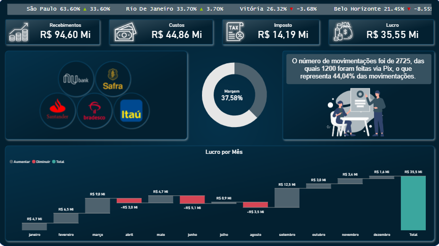

# 💰 Dashboard Financeiro | Financial Analytics & BI

## 📌 Visão Geral
Este projeto apresenta um **Dashboard Financeiro** desenvolvido em **Power BI**, com foco em **análise financeira estratégica**, controle de resultados e acompanhamento de indicadores econômicos essenciais para a gestão do negócio.

O dashboard consolida informações de **recebimentos, custos, impostos, lucro, margem, métodos de pagamento e desempenho mensal**, oferecendo uma visão integrada da saúde financeira da operação.

---

## 🎯 Objetivo do Projeto
Disponibilizar uma solução analítica que permita:
- Monitorar resultados financeiros de forma centralizada
- Avaliar rentabilidade e margem operacional
- Analisar a evolução do lucro ao longo do tempo
- Entender o impacto de custos e impostos no resultado final
- Apoiar decisões estratégicas relacionadas a crescimento, eficiência e controle financeiro

---

## 📈 Indicadores e Métricas (KPIs)
- 💵 **Recebimentos Totais**
- 📉 **Custos Totais**
- 🧾 **Impostos**
- 💰 **Lucro**
- 📊 **Margem (%)**
- 🔁 **Volume de Movimentações**
- 💳 **Distribuição por Meio de Pagamento (ex: Pix)**
- 📅 **Lucro por Mês**
- 🏦 **Instituições Financeiras**

---

## 🧠 Análises Estratégicas
- Evolução mensal do lucro (ganhos e perdas)
- Impacto dos custos e impostos sobre a margem
- Participação dos meios de pagamento nas movimentações financeiras
- Comparativo de desempenho financeiro por período
- Identificação de meses críticos e meses de maior rentabilidade
- Suporte à tomada de decisão financeira e planejamento estratégico

---

## 🛠️ Tecnologias e Ferramentas Utilizadas
- **Power BI**
- **Power Query** (ETL e tratamento de dados)
- **DAX** para criação de métricas financeiras e KPIs
- **Excel** como fonte de dados
- Conceitos de **Financial Analytics**, **Business Intelligence** e **Data Visualization**

---

## 📂 Estrutura do Repositório
```text
Financial_Dashboard/
├── Financial Dashboard.pbix
├── Financial Data.xlsx
├── images/
│   └── financial_dashboard.png
├── README.md
````
---

## 📈 Visão Geral do Dashboard


---

## 📊 Principais Insights
- Visão clara da rentabilidade do negócio
- Identificação do impacto real de custos e impostos
- Análise da margem financeira consolidada
- Avaliação da eficiência financeira ao longo do tempo
- Apoio à gestão estratégica e controle financeiro

---

## 📬 Contato
Fico à disposição para conversar sobre este projeto, trocar ideias sobre **Análise de Dados, Business Intelligence, Engenharia ou Ciência de Dados**, além de discutir soluções orientadas a dados e novos desafios em tecnologia.

- 💼 LinkedIn: [Jéssica Fuentes](https://www.linkedin.com/in/j%C3%A9ssica-fuentes/)
